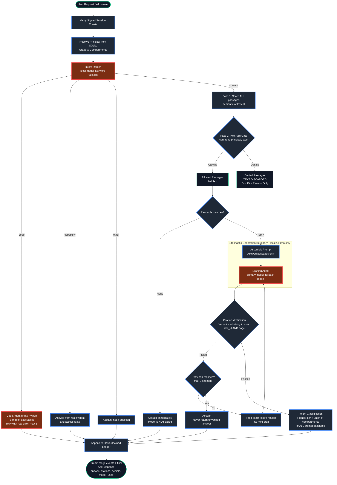
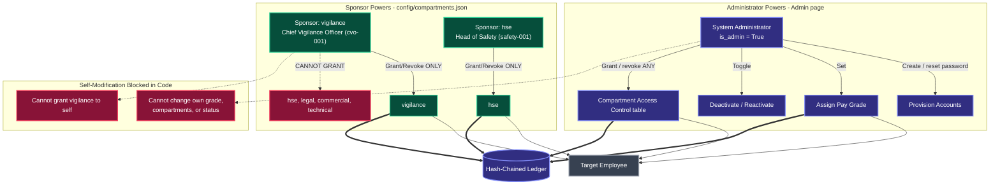

# SEVERANCE
### Sovereign Air-Gapped Document Trust Workbench for MRPL
*Smart India Hackathon 2026 — Problem Statement 26117*

---

## 1. The Thesis

SEVERANCE is a sovereign, air-gapped agentic document workbench built for Mangalore Refinery and Petrochemicals Limited (MRPL) that automates Section 10 of India's Right to Information (RTI) Act 2005 ("Severability") at the passage level. Grounded in the principle that **the model proposes, the code disposes**, every access decision, two-axis security gate, citation verification, and audit entry is enforced by deterministic Python code — never by a model. Hierarchical rank is decoupled from orthogonal compartments, denied text is discarded at the retrieval boundary before any prompt is assembled, and every quoted citation must match the source verbatim or the answer is withheld.

All language, code, vision, and embedding models run **locally through Ollama**. There is no cloud LLM fallback anywhere in the codebase: document and question content never leaves the machine.

---

## 2. What the Workbench Does

| Capability | How it works |
|---|---|
| **Document Q&A** | Classifies the request, searches the corpus (semantic or lexical), gates every passage through the two-axis access check, drafts an answer with a local model, and verifies every citation verbatim before returning it. |
| **Code requests** | Routed to a dedicated local code model; the script is executed in a sandboxed subprocess and only returned if it actually runs. Requests naming Java/C++/etc. are answered with an equivalent Python script (the sandbox runs Python only). |
| **File & image analysis** | Upload a PDF, PowerPoint, or image. Text pages go through the same citation-verified drafting; images are described by a local vision model and clearly labeled as unverified observations. |
| **Approval notes** | From an uploaded inspection report, extracts verified findings, adds visual observations, and drafts a formal approval note downloadable as Word. |
| **Reports** | Every answered query can be downloaded as DOCX, PPTX, or XLSX with classification stamping. |
| **Conversation memory** | Follow-up questions continue the same conversation, so "that" and "it" resolve against the last turns. History is persisted per user. |
| **Audit ledger** | Every query, grant, and account change is appended to a SHA-256 hash-chained ledger that can be verified from the UI. |
| **Live transparency** | The UI shows each pipeline step as it happens (Scan → Extract → Consult → Draft), which agent is running, and which local model it is using. |

---

## 3. System Architecture & Request Path

The pipeline strictly separates deterministic code from stochastic model generation. Models are only ever called with passages the caller is cleared to read, and nothing they produce is trusted until deterministic code has checked it.



Every stage boundary is streamed to the browser as newline-delimited JSON (`POST /ask/stream`), which is what drives the live activity log and step indicator in the UI.

---

## 4. The Two-Axis Access Control Model

Access is evaluated on two orthogonal axes. **Both must pass independently.** High rank grants no compartment visibility.

```mermaid
flowchart LR
    classDef axis1 fill:#1e3a8a,stroke:#60a5fa,stroke-width:2px,color:#ffffff;
    classDef axis2 fill:#14532d,stroke:#4ade80,stroke-width:2px,color:#ffffff;
    classDef decision fill:#374151,stroke:#f59e0b,stroke-width:2px,color:#ffffff;
    classDef outcomePass fill:#064e3b,stroke:#10b981,stroke-width:2px,color:#ffffff;
    classDef outcomeFail fill:#7f1d1d,stroke:#f87171,stroke-width:2px,color:#ffffff;

    subgraph Axis1 [Axis 1: Hierarchical Rank - Ladder]
        direction TB
        G_I["Grade I: Director / C&MD (Rank 15)"]:::axis1
        G_H["Grade H: Executive Director (Rank 14)"]:::axis1
        G_G["Grade G: Group General Manager (Rank 13)"]:::axis1
        G_F["Grade F: General Manager (Rank 12)"]:::axis1
        G_E["Grade E: Deputy General Manager (Rank 11)"]:::axis1
        G_D["Grade D: Chief Manager (Rank 10)"]:::axis1
        G_C["Grade C: Senior Manager (Rank 9)"]:::axis1
        G_B["Grade B: Manager (Rank 8)"]:::axis1
        G_A["Grade A: Executive / AM (Rank 7)"]:::axis1
        G_JM["Non-Management JM1-JM6 / TS1-TS6"]:::axis1
        G_S["Non-Management S1-S4"]:::axis1
    end

    subgraph Axis2 [Axis 2: Compartments - Independent Unranked Sets]
        direction TB
        C_HSE["hse (Health, Safety, Environment)"]:::axis2
        C_VIG["vigilance (Anti-Corruption & CVC)"]:::axis2
        C_LEG["legal (Contracts & Litigation)"]:::axis2
        C_COM["commercial (Procurement & Pricing)"]:::axis2
        C_TEC["technical (Refinery Process Secrets)"]:::axis2
    end

    subgraph AccessGate [Evaluation Gate in trust/labels.py]
        direction TB
        Cond1{"Rank >= TIER_FLOOR[tier]?"}:::decision
        Cond2{"doc.compartments is subset of\nuser.compartments?"}:::decision
    end

    Axis1 --> Cond1
    Axis2 --> Cond2

    Cond1 -->|No| Denied[DENIED: Insufficient Rank Floor]:::outcomeFail
    Cond2 -->|No| DeniedComp[DENIED: Missing Compartment]:::outcomeFail
    Cond1 -->|Yes| BothPass{Both Conditions Met?}:::decision
    Cond2 -->|Yes| BothPass
    BothPass -->|Yes| Allowed[ALLOWED to Read]:::outcomePass

    subgraph DemoInversion [The Headline Inversion Demo]
        GM["General Manager (Grade F, Rank 12)\nCompartments: {commercial}"]
        AM["Assistant Manager (Grade A, Rank 7)\nCompartments: {vigilance}"]
        DocVig["Vigilance Investigation Report\nTier: Confidential (Floor Rank 7)\nCompartment: vigilance"]

        GM -.->|Evaluated against DocVig| DeniedComp
        AM -.->|Evaluated against DocVig| Allowed
    end
```



Tier floors: `public` 0, `internal` 1, `confidential` 7, `secret` 11.

---

## 5. The Permission Model

Nobody can modify their own grade, compartments, or account status, and every change is written to the audit ledger.



- **Sponsors** (declared in `config/compartments.json`) may grant and revoke only their own compartment, and never to themselves. Sponsorship does not grant read access to the sponsor.
- **The System Administrator** can assign any set of compartments to any *other* active user from the **Compartment Access Control** table (`PUT /admin/users/{id}/compartments`). Each save records exactly what was added and removed in the ledger.
- Being a sponsor is separate from being able to read a compartment: `cvo-001` can grant `vigilance` to others, but needs it granted (by the administrator) to read vigilance documents.

---

## 6. The Local Models

| Role | Default model | Used for |
|---|---|---|
| Primary | `gemma3:4b` | Intent routing, document answers, capability answers, approval notes |
| Fallback | `qwen3.5:2b-q4_K_M` | Tried automatically if the primary model produces no citations |
| Vision | `qwen3.5:2b-q4_K_M` | Describing uploaded images and scanned pages |
| Code | `qwen2.5-coder:3b` | Writing Python scripts for code requests |
| Embeddings | `nomic-embed-text` | Semantic retrieval (`SEVERANCE_RETRIEVAL_MODE=semantic`) |

Any locally installed Ollama models can be substituted through `.env`. The **Models** page shows which configured models are actually installed, and highlights the one the agent is using right now.

---

## 7. The Web UI

The React UI (`ui-react/`) is served by FastAPI from its production build in `ui-react/dist`.

| Page | Purpose |
|---|---|
| **Workbench** | Ask questions, attach files, draft approval notes, download reports. Shows the live Scan → Extract → Consult → Draft steps, a live agent activity log (agent, model, outcome, timing), and the model in use. |
| **Sovereignty** | Browse the audit ledger and verify the hash chain. |
| **Knowledge Base** / **Documents** | Corpus statistics and per-user readability of every document, with the exact denial reason. |
| **Models** | Configured local models, install status, and the live active model. |
| **Generated Outputs** | Conversation history with rename, delete, and report downloads. |
| **Administration** | Provision users, reset passwords, set grades, activate/deactivate, and assign compartments (admin); grant/revoke own compartment (sponsors). |
| **Profile** | Account details, clearances, and password change. |

---

## 8. Project Structure

```
sih2/
├── contracts.py               # Shared Pydantic shapes & enums — the cross-file vocabulary
├── API.md                     # REST API reference
├── requirements.txt           # Python dependencies
├── .env.example               # Environment template
├── Dockerfile / docker-compose.yml
│
├── api/
│   ├── main.py                # FastAPI app, .env loading, startup checks, React SPA serving
│   └── routes/
│       ├── auth.py            # login, logout, change-password
│       ├── admin.py           # users, grades, password reset, activation, compartment assignment
│       ├── grants.py          # sponsor grant/revoke, /grants/mine
│       ├── ask.py             # /ask, /ask/stream, uploads, approval notes, report downloads
│       ├── documents.py       # corpus listing with per-user readability
│       ├── conversations.py   # persisted conversation history
│       ├── ledger.py          # audit ledger read & chain verification
│       └── models.py          # configured local models + install status
│
├── agents/
│   ├── base.py                # Agent protocol (no principal/clearance in the signature)
│   ├── real.py                # Local Ollama agent: intent routing, drafting, code, vision
│   ├── sandbox.py             # Subprocess code execution with timeout & limits
│   ├── mock.py                # Deterministic offline agent for tests
│   └── adk.py                 # Google ADK adapter (optional)
│
├── harness/
│   ├── runner.py              # Query lifecycle: route, retrieve, draft, verify, retry, abstain
│   ├── code_runner.py         # Code request loop: draft, execute, feed back real errors
│   ├── approval_note.py       # Inspection report -> verified findings -> approval note
│   ├── retrieve.py            # Two-pass retrieval: score everything, gate, discard denied text
│   ├── semantic.py            # Embedding-based scoring via local Ollama
│   └── verify.py              # Deterministic verbatim citation verifier
│
├── trust/
│   ├── labels.py              # RANK, TIER_FLOOR, can_read(), inherit_label()
│   ├── ledger.py              # SHA-256 hash-chained audit ledger
│   ├── conversations.py       # Per-user conversation store & recent-turn context
│   └── reports.py             # Full answer storage for report regeneration
│
├── auth/
│   ├── users.py               # scrypt password hashing, provisioning, grades
│   ├── sponsors.py            # Sponsor grants, delegation, admin compartment assignment
│   ├── session.py             # HMAC-SHA256 signed session cookies
│   └── deps.py                # FastAPI auth dependencies
│
├── ingest/
│   ├── pdf.py                 # Page-level PDF extraction (optional OCR)
│   ├── ephemeral.py           # In-memory per-user uploads: PDF, PPTX, images
│   └── seed.py                # First-run administrator bootstrap
│
├── deliver/                   # DOCX, PPTX, XLSX reports and approval-note DOCX
├── config/compartments.json   # Compartment -> sponsor declaration
├── corpus/                    # manifest.json (labels) + documents/ (PDFs)
├── ops/network_monitor.py     # Live outbound-connection monitor for demos
├── scripts/                   # create_admin, create_employee, grant_compartment, fixtures
├── tests/                     # pytest suite
├── ui-react/                  # React + Vite + Tailwind frontend (src/ and built dist/)
└── ui/                        # Legacy static HTML UI (used only if ui-react/dist is absent)
```

---

## 9. Setup and Run

### Prerequisites
- Python 3.11+
- [Ollama](https://ollama.com) running locally
- Node.js 18+ (only if you want to rebuild or develop the frontend — a production build is already committed)

### Step 1: Pull the local models
```bash
ollama pull gemma3:4b
ollama pull qwen3.5:2b-q4_K_M
ollama pull qwen2.5-coder:3b
ollama pull nomic-embed-text
```

### Step 2: Configure the environment
```bash
cp .env.example .env
```
Key settings in `.env`:
```ini
SEVERANCE_SECRET_KEY=change-this-in-production-to-a-secure-random-token
SEVERANCE_ADMIN_ID=admin-001
SEVERANCE_ADMIN_PASSWORD=InitialAdminPassword123!
SEVERANCE_DB_PATH=severance.db

AGENT_BACKEND=ollama              # 'ollama' (local), 'mock' (offline canned), or 'adk'
OLLAMA_API_BASE=http://localhost:11434
OLLAMA_MODEL=gemma3:4b
OLLAMA_FALLBACK_MODEL=qwen3.5:2b-q4_K_M
OLLAMA_VISION_MODEL=qwen3.5:2b-q4_K_M
OLLAMA_CODE_MODEL=qwen2.5-coder:3b

SEVERANCE_RETRIEVAL_MODE=semantic # or 'lexical' (no embedding model needed)
SEVERANCE_ENABLE_OCR=false        # 'true' requires the optional paddleocr package
SANDBOX_TIMEOUT_SECONDS=8
CONVERSATION_MEMORY_TURNS=2
```
`.env` is loaded automatically at startup. Changing the secret key invalidates existing login sessions.

### Step 3: Install Python dependencies
```bash
python -m venv venv
# Windows: venv\Scripts\activate    macOS/Linux: source venv/bin/activate
pip install -r requirements.txt
```

### Step 4: Run the test suite
```bash
python -m pytest tests/
```

### Step 5: Start the server
```bash
python -m uvicorn api.main:app --host 127.0.0.1 --port 8080
```
Open **http://localhost:8080**. On first startup the database is created and the administrator account from `.env` is seeded.

### Step 6: Create the sponsor accounts
Startup warns until every sponsor in `config/compartments.json` exists. Log in as `admin-001`, open **Administration** (top-right menu), and create:

| Employee ID | Role | Sponsors |
|---|---|---|
| `cvo-001` | Chief Vigilance Officer | vigilance |
| `safety-001` | Head of Safety | hse |
| `legal-001` | Company Secretary | legal |
| `comm-001` | GM Commercial | commercial |
| `tech-001` | GM Technical | technical |

Each gets a temporary password to change on first login. Alternatively, from the command line:
```bash
python scripts/create_employee.py --id cvo-001 --name "Chief Vigilance Officer" --job-title "Chief Vigilance Officer" --grade H --password "YourPassword123!"
```
Then grant compartments from the **Compartment Access Control** table (administrator) or by logging in as a sponsor.

### Frontend development (optional)
```bash
cd ui-react
npm install
npm run dev      # http://localhost:3000, proxies API calls to :8080
npm run build    # rebuilds ui-react/dist, served by FastAPI
```

---

## 10. Honest Engineering Boundaries

1. **Docker deployment is not yet verified.** `Dockerfile` and `docker-compose.yml` exist (with an `internal: true` network intended to make outbound traffic impossible), but they have not been run end to end. The compose file does not yet pass the model settings above, and an internal-only network can prevent the UI port from being published. Local development runs directly on the host.
2. **The code sandbox is process-level, not container-level.** Generated scripts run in a separate Python subprocess with a stripped environment and a wall-clock timeout. The memory limit applies only on Linux/macOS, and the subprocess is not blocked from the network or from reading host files. Full isolation requires running each execution in its own locked-down container.
3. **Small local models are imperfect.** Answers that cannot be verified verbatim are withheld rather than shown — for noisy scanned sources (e.g. documents with OCR typos) this means some questions correctly return "Response withheld" instead of an answer.
4. **OCR is optional.** Scanned PDFs without a text layer are rejected with `ScannedPdfError` unless `SEVERANCE_ENABLE_OCR=true` and `paddleocr` is installed. Uploaded scans can still be read by the vision model, with its output labeled unverified.
5. **Uploads are ephemeral.** Uploaded files are held in memory per user and are lost on server restart.
6. **Single-node ledger.** The audit ledger is tamper-evident (any modification breaks the SHA-256 chain) but is a local SQLite table, not a distributed ledger. Session tokens are HMAC-signed with a configured secret, not hardware-backed.
7. **Real MRPL documents are not included.** The repository ships a labeled manifest and sample PDFs; authorized administrators add real documents to `corpus/documents/` and label them in `corpus/manifest.json`.
